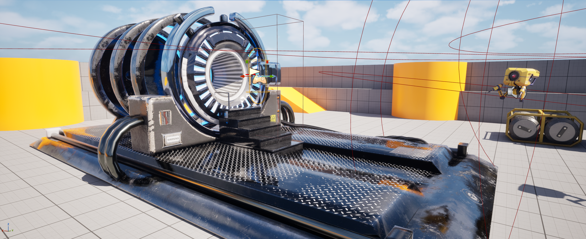
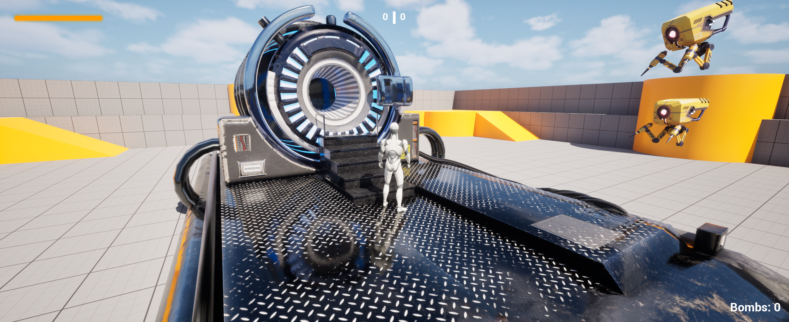
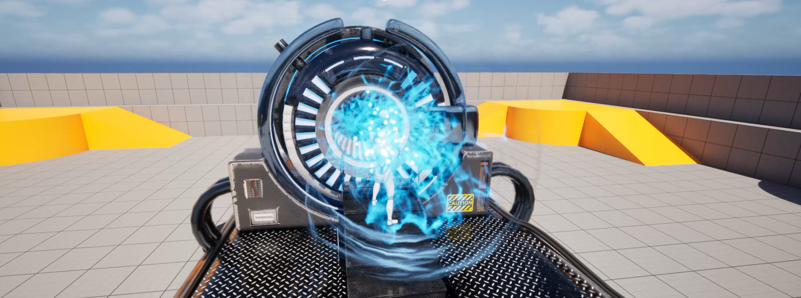
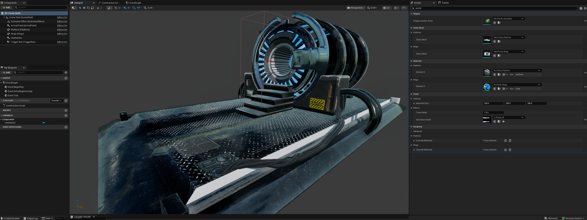
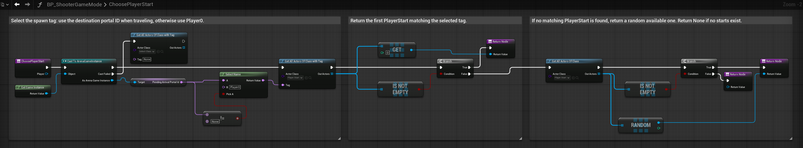
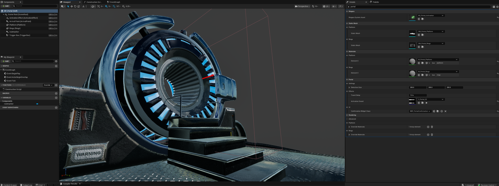
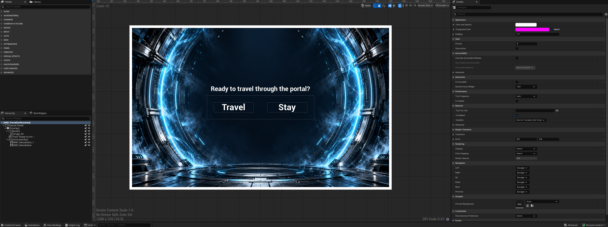
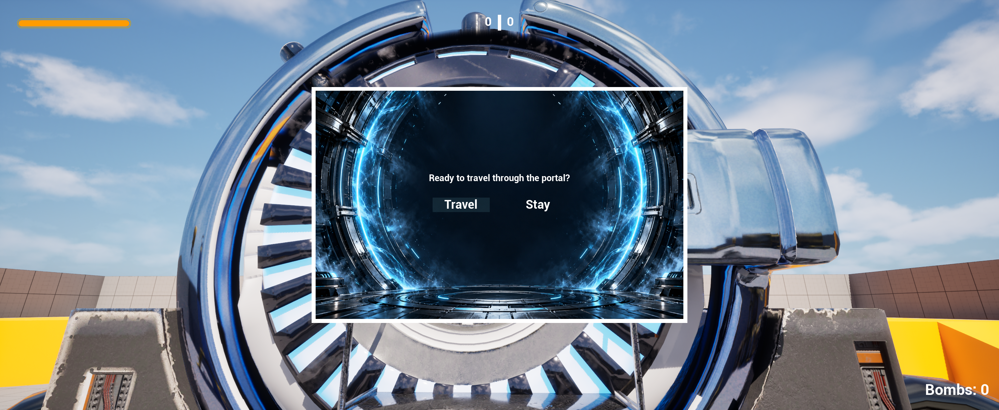

# Sci-Fi Portal — Unreal Engine C++

A sci-fi portal supporting two-way travel between Unreal Engine levels. This repository showcases the mechanic through C++ source code, a demonstration video, and editor and gameplay screenshots. The mechanic was developed in an ArenaShooter test environment adapted for a single local player.

## Demo Video

[▶ Watch the demo on YouTube](https://youtu.be/6hkQV0Xnbpk)

## Features

- Player detection through a configurable box overlap area.
- Two-way level travel using independently configured portal destinations.
- Niagara activation effect customized with blue particles.
- Activation sound played at the trigger location.
- Configurable delay between activation and level travel.
- Repeated activation blocked while a transition is in progress.
- Destination portal ID preserved between maps through a custom GameInstance.
- Blueprint GameMode spawn selection using tagged PlayerStart actors.
- Separate spawn points for normal gameplay and portal arrivals.
- Arrival completion aligns the control rotation with the spawned pawn and clears the pending destination.
- Event-driven activation with actor ticking disabled.
- Optional diagnostic logging controlled by the `PORTAL_DEBUG` macro.

## Scene Preview

### Portal Placement in the Test Arena



### Player Approaching the Portal



### Activation Effect



## C++ Implementation

The portal actor is declared in [`Portal.h`](Portal.h), with its behavior implemented in [`Portal.cpp`](Portal.cpp). A Blueprint subclass, `BP_Portal`, configures component transforms and effect assets in the editor.

### Components

| Component | Purpose |
|---|---|
| `SceneRoot` | Shared transform for the portal components |
| `Platform` | Platform mesh and material |
| `Rings` | Portal ring mesh and material |
| `TriggerBox` | Query-only detection area overlapping the Pawn channel |
| `ActivationEffect` | Niagara component, initially inactive |
| `ArrivalPoint` | Editor reference marker retained from the original arrival implementation; it no longer sets the player position |



### Detection and Activation

`BeginPlay()` binds `OnTriggerBeginOverlap()` to the trigger's overlap event. The callback only accepts the pawn belonging to player index `0`. It ignores overlaps while this portal is already transitioning or while the GameInstance contains a pending arrival.

After validating that a destination map and portal ID are assigned, the actor sets `bTravelInProgress`, activates Niagara, and optionally plays `ActivationSound` through `UGameplayStatics::PlaySoundAtLocation`. A one-shot timer calls `CompleteTravel()` after `TravelDelay`.

Leaving the trigger does not cancel an activated transition. The sound and effect belong to the current world and can be cut short when that world unloads.

### Level Travel and Persistent Destination

`CompleteTravel()` stores `DestinationPortalId` in `UArenaGameInstance::PendingArrivalPortalId`, then opens `DestinationLevel` using `UGameplayStatics::OpenLevelBySoftObjectPtr`.

The GameInstance survives level changes, allowing the destination GameMode to read the pending ID before spawning the player. `DestinationLevel` uses a soft object reference, so assigning a map does not require keeping that destination world loaded alongside the portal.

### Spawn Selection in Blueprints

The GameMode's `ChoosePlayerStart` override selects an **Actor Tag**:

- If `PendingArrivalPortalId` is set, use that ID, such as `Portal_B`.
- Otherwise, use `Player0` for a normal game start.

It searches for PlayerStart actors with the selected tag and returns the first match. If none is found, the normal fallback searches all PlayerStart actors and returns a random available one. An empty fallback list returns `None`.



The GameMode selects the spawn location directly. This avoids briefly spawning at the normal start and then visibly teleporting to the portal.

### Arrival Completion

On the destination map, the portal whose `PortalId` matches the pending ID starts a repeating timer at `0.1`-second intervals. Despite its retained name, `TryPlacePlayerAtArrival()` no longer teleports the pawn. It waits for a player controller and pawn, matches the control rotation to the pawn's rotation, clears the pending ID, and stops the timer.

**The tagged PlayerStart controls arrival position and rotation, not `ArrivalPoint`.** Place it outside the trigger with enough space for the player's capsule. The pending-arrival guard protects the completion period; it is not a replacement for keeping the arrival point outside the activation area.

## Exposed Settings

| Property | Meaning | C++ default |
|---|---|---|
| `DetectionSize` | Local box half-extents, X × Y × Z | 200 × 200 × 200 cm |
| `PortalId` | This portal's identifier, unique within its level | None |
| `DestinationLevel` | Map to open | None |
| `DestinationPortalId` | Destination portal ID and matching PlayerStart Actor Tag | None |
| `TravelDelay` | Delay before opening the destination map | 1 s |
| `ActivationSound` | Optional activation sound asset | None |

`DetectionSize` is passed directly to `SetBoxExtent()`: a value of `200` produces a full size of `400` cm along that axis at unit scale. `OnConstruction()` updates the box when settings change in the editor. Portal travel properties use `EditInstanceOnly` and are configured on actors placed in a level.

Set `PORTAL_DEBUG` to `1` in `Portal.cpp` and recompile to enable diagnostic messages. Set it to `0` to omit those guarded log statements. The missing-destination warning remains outside this switch.

## Example Two-Way Configuration

| Setting | Portal on map A | Portal on map B |
|---|---|---|
| `PortalId` | `Portal_A` | `Portal_B` |
| `DestinationLevel` | Map B | Map A |
| `DestinationPortalId` | `Portal_B` | `Portal_A` |
| Arrival PlayerStart Actor Tag | `Portal_A` | `Portal_B` |

Each map also has a separate PlayerStart tagged `Player0` for normal starts and the single-player respawn configuration. Portal arrival starts should not also carry `Player0`.

## Using the Source in an Unreal Engine Project

1. Add `Portal.h` and `Portal.cpp` to an Unreal Engine C++ project. Replace `ARENASHOOTER_API` with your module's API macro if necessary.
2. Enable Niagara and add `"Niagara"` to the appropriate dependency list in your module's `.Build.cs` file.
3. Supply a custom `UArenaGameInstance` class with a public `FName PendingArrivalPortalId`, initialized to `NAME_None`. Select it in **Project Settings → Maps & Modes → Game Instance Class**. The supplied portal source includes `ArenaGameInstance.h`, which is not included in this repository.
4. Obtain the portal assets separately. The constructor expects these references:

   ```text
   /Game/Portals/SciFiPortal/SM_Portal_Platform.SM_Portal_Platform
   /Game/Portals/SciFiPortal/SM_Portal_Rings.SM_Portal_Rings
   /Game/Portals/SciFiPortal/M_Portal_Platform.M_Portal_Platform
   /Game/Portals/SciFiPortal/M_Portal_Rings.M_Portal_Rings
   ```

5. Preserve those paths, update them, or remove the constructor asset-loading blocks and assign your own assets in a Blueprint subclass.
6. Compile and create `BP_Portal` derived from `APortal`. Arrange the meshes and trigger, assign a Niagara System to `ActivationEffect`, and assign an activation sound. Keep Niagara Auto Activate disabled.
7. Configure the active GameMode on both maps with the `ChoosePlayerStart` logic described above. Ensure the fallback query has its Actor Class set to `PlayerStart`, and route a failed GameInstance cast to a valid fallback path.
8. Place one normal `Player0` start and one uniquely tagged arrival start per portal. Use **Actor → Tags**, not the separate Player Start Tag field. Keep arrival starts outside the portal trigger and clear of blocking geometry.
9. Configure both portal instances as shown in the table. Ensure platform collision supports walking and that ring collision leaves the passage accessible. Enable overlap generation on the player's collision component.
10. Include destination maps in the packaged build and test normal startup, travel in both directions, facing direction, and repeated activation.

## Current Scope and Future Improvements

- The implementation targets one local player; multiplayer travel and replication are not implemented.
- UI confirmation was added in the October 28, 2026 update documented below. Persistent saving of level or player state is not implemented; GameInstance currently carries the destination ID between levels.
- Add arrival timeouts and travel-failure recovery. A pending ID needs to be cleared if its destination portal cannot complete arrival; otherwise, the overlap guard can keep portals inactive. The supplied portal files do not implement this recovery themselves.
- Keep missing-destination recovery compatible with streamed levels: a portal that has not loaded yet should not be treated as permanently absent.
- Rename `TryPlacePlayerAtArrival()` to reflect its completion-only role and remove or repurpose the unused `ArrivalPoint` marker.

## Asset Credits

- **Portal model:** [Sci-fi Portal](https://www.fab.com/listings/f20beba3-c436-4a5e-8f57-69219a378577) by **Sousinho Games**, available on Fab. Integrated with custom C++ behavior and configured materials.
- **Visual effects:** [Free Magic Niagara](https://www.fab.com/listings/d0fe50c4-6ebe-40d5-b78a-56960832f49e) by **Lord Enot Store**, available on Fab. Customized for the blue portal activation effect.
- **Audio:** [Science Fiction Teleportation Sound Effect](https://freesound.org/people/Mastersoundboy2005/sounds/761012/) by **Mastersoundboy2005**, available on Freesound under **CC0**.

Obtain third-party assets from their original listings and follow their applicable license terms. The arena and other props shown in the demonstration provide test-scene context.

## Repository Contents

| File | Description |
|---|---|
| [`Portal.h`](Portal.h) | Actor declaration, components, travel settings, and timer state |
| [`Portal.cpp`](Portal.cpp) | Detection, activation effects, delayed level travel, and arrival completion |
| `screenshots/screenshot-01.png` | Portal placement in the arena |
| `screenshots/screenshot-02.png` | Blueprint components and editor configuration |
| `screenshots/screenshot-03.png` | Player approaching the portal |
| `screenshots/screenshot-04.png` | Niagara activation effect |
| `screenshots/screenshot-05-chooseplayerstart.png` | Blueprint spawn selection logic |

This is a **source-code and visual showcase**, not a complete Unreal Engine project. It does not include a `.uproject`, the GameInstance source, Blueprint assets, levels, or external mesh, material, texture, Niagara, and audio assets. Cloning the repository alone does not provide a runnable project; the integration steps describe the additional dependencies.

## Update — October 28, 2026: Portal Travel Confirmation UI

Added a confirmation menu so entering the portal trigger no longer starts travel immediately. The player can choose **Travel** to proceed or **Stay** to remain in the current level.

[▶ Watch the UI confirmation showcase on YouTube](https://youtu.be/ePFBZXJpI28)

### Interaction Flow

1. Entering the portal trigger opens `WBP_PortalConfirmation`.
2. The menu shows **“Ready to travel through the portal?”** with **Travel** and **Stay** buttons.
3. While the menu is open, the cursor is visible, input is switched to UI-only mode, and movement and look input are blocked. Character movement is stopped when the menu opens.
4. **Travel** closes the menu, restores gameplay controls, and calls `StartTravel()`. The Niagara effect and activation sound begin, followed by the configured delay and level transition.
5. **Stay** closes the menu and restores gameplay controls without starting travel.

The menu is a centered sci-fi panel with a custom background, reusable Common UI buttons, and hover and click sounds. A portal does not create another confirmation window while its current window is open or travel is already in progress. Each widget instance accepts only one decision.

### C++ and Blueprint Integration

- [`PortalConfirmationWidget.h`](PortalConfirmationWidget.h) declares the Blueprint-callable `ConfirmTravel()` and `CancelTravel()` functions and the `OnTravelConfirmed` / `OnTravelCancelled` multicast delegates.
- [`PortalConfirmationWidget.cpp`](PortalConfirmationWidget.cpp) broadcasts the selected action and uses `bDecisionMade` to prevent repeated decisions from the same widget instance.
- [`Portal.h`](Portal.h) exposes `ConfirmationWidgetClass` and stores the active widget reference.
- [`Portal.cpp`](Portal.cpp) creates the widget, binds its delegates, manages input and cursor state, and handles confirmation or cancellation. Activation effects, audio, and the travel timer are grouped in `StartTravel()`.
- `WBP_PortalConfirmation` inherits from `UPortalConfirmationWidget`. Its reusable `WBP_MenuButton` instances call `ConfirmTravel()` for **Travel** and `CancelTravel()` for **Stay** through their `On Button Base Clicked` events.

### Setup Additions

1. Add the two `PortalConfirmationWidget` source files alongside the updated portal files. Keep `Niagara` and add `UMG` to the module dependencies in `.Build.cs`.
2. Enable **Common UI** to recreate the reusable buttons shown in this showcase.
3. Create or reparent `WBP_PortalConfirmation` to `PortalConfirmationWidget`, then connect both button click events as described above.
4. In `BP_Portal` Class Defaults, set **Portal → UI → Confirmation Widget Class** to `WBP_PortalConfirmation`.
5. Remove any temporary BeginPlay test that displays the menu automatically. The portal overlap now opens it.
6. Test both choices: **Stay** must preserve the current level, while **Travel** must start the existing effect, sound, and transition sequence.

The repository remains a source-code and visual showcase. Widget Blueprints, Common UI style assets, imported sounds, and level assets must be configured in an Unreal Engine project separately.

### UI Screenshots

#### Portal Configuration



#### Widget Layout in the Designer



#### Confirmation Menu During Gameplay



### UI Asset Credits

- **UI graphics:** [UI Pack – Sci-Fi](https://kenney.nl/assets/ui-pack-sci-fi) by **Kenney**.
- **Button audio:** [Sci-Fi UI Button Sound 019](https://freesound.org/people/crash_358/sounds/615543/) by **crash_358**, and [Scifi Inspect Sound UI or In-Game Notification 01](https://freesound.org/people/lilmati/sounds/657945/) by **lilmati**, available on Freesound. Refer to the original sound pages for their applicable licenses.
- **Menu background:** AI-generated artwork included as [`portal-ui-background.png`](portal-ui-background.png).

